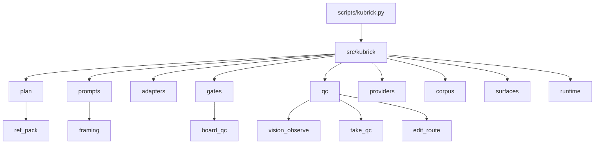

<p align="center">
  
</p>

<h1 align="center">Kubrick</h1>

<p align="center">
  <strong>Observed form first. Dramatic function first.</strong><br>
  A Hermes skill that turns a brief into continuity-safe storyboards and prompts.<br>
  <em>0.27.9: Retrieval takes a second-opinion dramatic fit verdict</em>
</p>

<p align="center">
  <a href="https://github.com/Zero-State-LLC/Kubrick">Repository</a>
  ·
  <a href="https://github.com/Zero-State-LLC/Kubrick/issues">Issues</a>
  ·
  <a href="https://github.com/orgs/Zero-State-LLC/projects/13">Project board</a>
  ·
  <a href="QUICKSTART.md">Quickstart</a>
  ·
  <a href="SKILL.md">Skill contract</a>
  ·
  <a href="docs/ROADMAP.md">Roadmap</a>
  ·
  <a href="CHANGELOG.md">Changelog</a>
</p>

---

## Tags

<p align="center">
  <a href="https://github.com/Zero-State-LLC/Kubrick/releases"></a>
  <a href="https://github.com/Zero-State-LLC/Kubrick/actions/workflows/ci.yml"></a>
  <a href="https://github.com/Zero-State-LLC/Kubrick/stargazers"></a>
  <a href="https://github.com/Zero-State-LLC/Kubrick/issues"></a>
  <a href="LICENSE"></a>
</p>

Repository topics for this repo: `hermes-skill`, `cinematography`, `storyboard`, `continuity`, `film-grammar`.

<p align="center">
  
  
  
  
  
</p>

## Layout

`python scripts/kubrick.py` is the command. Production code lives in `src/kubrick/`. Each `scripts/<name>.py` file is the entry point that loads the matching module. Tests stay in `scripts/`.



Take QC core scores fixture measurements in `src/kubrick/qc/vision_observe.py`. Full take QC in `src/kubrick/qc/take_qc.py` adds fixture VLM verdicts, identity similarity, and timestamps, and runs ffmpeg only through an injected runner. The board gate in `src/kubrick/gates/board_qc.py` checks a start board before video spend. The board image gate in `src/kubrick/gates/board_image_gate.py` looks at the board pixels in `video runbook`, on by default: a DINOv2 similarity to the approved `ref_pack` views (default floor 0.50, calibrated on EP-01 as an off-model floor; a medium or wide board needs a head box in `board_subject_boxes`) and yes-or-no lock checks from a local judge. A failure blocks spend (`BOARD_IDENTITY_MISMATCH`, `BOARD_LOCK_DETAIL_FAIL`), and a check that cannot run is UNVERIFIED and blocks too, unless `--board-image-opt-out REASON` is logged. Numeric framing in `src/kubrick/prompts/framing.py` writes a motion-only video line when a start frame is used and records an end anchor Keyframe cannot store. The reference pack in `src/kubrick/plan/ref_pack.py` is one hash shared across movies. The retake router in `src/kubrick/qc/edit_route.py` recommends a mask, a re-board, a re-plan, or a reference fix and does not spend. See [`docs/TAKE-QC.md`](docs/TAKE-QC.md), [`docs/BOARD-GATE.md`](docs/BOARD-GATE.md), [`docs/JEV-PRE-SPEND-GATE.md`](docs/JEV-PRE-SPEND-GATE.md), [`docs/FRAMING.md`](docs/FRAMING.md), and [`docs/REF-PACK.md`](docs/REF-PACK.md).


## Tokens

Kubrick has no color, type, or spacing tokens. The name `design_tokens` in
[`scripts/surface_design.py`](scripts/surface_design.py) and
[`scripts/surface_design_extra.py`](scripts/surface_design_extra.py) is a
word-overlap set, not a visual system.

Words the code actually emits:

| Token | Meaning |
|---|---|
| `PROPOSED` | Local creative output, not canon |
| `OBSERVATION` | Recorded evidence |
| `PROPOSAL` | A change that is not applied |
| `NOT_COMPUTABLE` | Weak or contradictory evidence; fail closed |

The product version is the `VERSION` file (`0.27.9`). The production envelope
schema id stays `0.16.0` and does not track that version.

## Atlas

Production code lives in [`src/kubrick/`](src/kubrick/). Each `scripts/<name>.py`
file loads that module. Tests stay in `scripts/`. [`skills/kubrick/`](skills/kubrick/)
is the packaging mirror. Root is the source of truth. The map is the layout
diagram above. The Keyframe adapter is [`scripts/adapt_keyframe.py`](scripts/adapt_keyframe.py).

| Path | Role |
|---|---|
| [`SKILL.md`](SKILL.md) | Hermes behavior contract |
| [`scripts/kubrick.py`](scripts/kubrick.py) | Intent router |
| [`assets/grammar/film_grammar.yaml`](assets/grammar/film_grammar.yaml) | Film grammar 1.1.0 |
| [`scripts/film_grammar.py`](scripts/film_grammar.py) | Grammar loader |
| [`scripts/prompt_text.py`](scripts/prompt_text.py) | Prompt assembly |
| [`scripts/continuity_locks.py`](scripts/continuity_locks.py) | Wardrobe, prop, and reference locks |
| [`scripts/jev_gate.py`](scripts/jev_gate.py) | Hold check before video spend |
| [`scripts/spend_plan.py`](scripts/spend_plan.py) | Inferred spend |
| [`scripts/production_engine.py`](scripts/production_engine.py) | Shared production engine |
| [`references/`](references/) | Corpus and runtime contracts |
| [`docs/ROADMAP.md`](docs/ROADMAP.md) | Current roadmap |

Carrier order, when a shot has those pieces: start image, then references,
then end image, then prompt. See [`docs/CONTINUITY.md`](docs/CONTINUITY.md).

## Roadmap

Board: [project 13](https://github.com/orgs/Zero-State-LLC/projects/13).
Full list: [`docs/ROADMAP.md`](docs/ROADMAP.md). Release notes: [`CHANGELOG.md`](CHANGELOG.md).

| Stage | Issue |
|---|---|
| Provider preflight | [#95](https://github.com/Zero-State-LLC/Kubrick/issues/95) |
| Prompt action and lint | [#96](https://github.com/Zero-State-LLC/Kubrick/issues/96), [#97](https://github.com/Zero-State-LLC/Kubrick/issues/97) |
| Film grammar 1.1.0 | [#109](https://github.com/Zero-State-LLC/Kubrick/issues/109) |
| Spend safety | [#98](https://github.com/Zero-State-LLC/Kubrick/issues/98) |
| Scoped holds | [#99](https://github.com/Zero-State-LLC/Kubrick/issues/99) |
| Restructure window | [#105](https://github.com/Zero-State-LLC/Kubrick/issues/105) |
| Docs pass | [#117](https://github.com/Zero-State-LLC/Kubrick/issues/117) |
| Take-check core | [#100](https://github.com/Zero-State-LLC/Kubrick/issues/100), [#107](https://github.com/Zero-State-LLC/Kubrick/issues/107) |
| Board gate | [#101](https://github.com/Zero-State-LLC/Kubrick/issues/101) |
| Numeric framing | [#102](https://github.com/Zero-State-LLC/Kubrick/issues/102) |
| Reference pack | [#103](https://github.com/Zero-State-LLC/Kubrick/issues/103) |
| Retake router | [#104](https://github.com/Zero-State-LLC/Kubrick/issues/104) |

[#91](https://github.com/Zero-State-LLC/Kubrick/issues/91) stays deferred.

## Install

```bash
git clone https://github.com/Zero-State-LLC/Kubrick.git
cd Kubrick
./install.sh
python scripts/kubrick.py do check --action smoke
```

Windows: `install.ps1`. OpenClaw uses the [`openclaw`](https://github.com/Zero-State-LLC/Kubrick/tree/openclaw) branch. See [`docs/OPENCLAW.md`](docs/OPENCLAW.md).

Copy-paste workflows: [`QUICKSTART.md`](QUICKSTART.md). Agent contract: [`AGENTS.md`](AGENTS.md).

| Job | What it does |
|---|---|
| `compile` | Brief and ledger to graph, storyboard, and packets |
| `retrieve` | Patterns for a dramatic problem |
| `ledger` | Project motif checklist |
| `design` / `script` / `image` / `video` | Production surfaces |
| `storyboard` | Multi-frame state |
| `adapt` | Provider syntax for one latent graph |
| `visual` | Expected frame versus observation |
| `learn` | Outcome proposals; never auto-applied |
| `check` | Skill, corpus, smoke |
| `operate` | Saturation, locks, export |
| `bundle` | Grok-oriented review bundle |
| `mcp` | Optional machine interface |
| `wizard` | Guided plan |

```bash
python scripts/kubrick.py do <job> [options…]
```

## License

Copyright © 2026 Zero State LLC. All Rights Reserved. Licensed under the Zero State Proprietary License v1.0. See [`LICENSE`](LICENSE).
