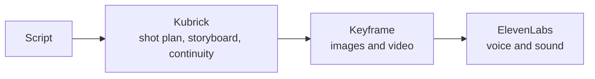

<p align="center">
  
</p>

<h1 align="center">Kubrick</h1>

<p align="center">
  An agent skill that turns a brief into continuity-safe storyboards and prompts.<br>
  Works as a skill for agents such as Hermes, Grok Bot and OpenClaw.<br>
  <em>0.27.14: The prompt compiler writes lock negative lines too</em>
</p>

<p align="center">
  <a href="https://github.com/Zero-State-LLC/Kubrick/releases"></a>
  <a href="https://github.com/Zero-State-LLC/Kubrick/actions/workflows/ci.yml"></a>
  <a href="https://github.com/Zero-State-LLC/Kubrick/stargazers"></a>
  <a href="https://github.com/Zero-State-LLC/Kubrick/issues"></a>
  <a href="LICENSE"></a>
</p>

<p align="center">
  Topics: <code>hermes-skill</code> · <code>cinematography</code> · <code>storyboard</code> · <code>continuity</code> · <code>film-grammar</code>
</p>

<p align="center">
  <a href="QUICKSTART.md">Quickstart</a> ·
  <a href="SKILL.md">Skill contract</a> ·
  <a href="docs/ROADMAP.md">Roadmap</a> ·
  <a href="CHANGELOG.md">Changelog</a> ·
  <a href="https://github.com/orgs/Zero-State-LLC/projects/13">Project board</a>
</p>

---

## What it does

Kubrick plans film work before you spend money on video. You give it a brief. It builds a shot graph, a storyboard, and prompts for each provider. It keeps wardrobe, props, and references locked across shots. It checks start boards and finished takes, and it blocks video spend when a check fails or cannot run. Its own output is marked `PROPOSED`. It never changes canon on its own.

Kubrick works as a skill for agents such as Hermes, Grok Bot and [OpenClaw](https://openclaw.ai/). It is packaged as a Hermes skill on `main`, and OpenClaw packaging lives on the [`openclaw`](https://github.com/Zero-State-LLC/Kubrick/tree/openclaw) branch.

## Quick start

```bash
git clone https://github.com/Zero-State-LLC/Kubrick.git
cd Kubrick
./install.sh
python scripts/kubrick.py do check --action smoke
```

The installer validates a staged copy before it activates it. Other useful flags:

```bash
./install.sh --dry-run    # preview the install
./install.sh --version    # show the source version
./install.sh --rollback   # restore the most recent backup
```

To work from the repository, install the runtime dependencies and validate the skill:

```bash
python3 -m pip install -r requirements.txt
python scripts/kubrick.py do check --action skill
```

Windows uses `install.ps1`. OpenClaw uses the [`openclaw`](https://github.com/Zero-State-LLC/Kubrick/tree/openclaw) branch; see [`docs/OPENCLAW.md`](docs/OPENCLAW.md). More workflows are in [`QUICKSTART.md`](QUICKSTART.md).

Every job runs through one command:

```bash
python scripts/kubrick.py do <job> [options…]
```

| Job | What it does |
|---|---|
| `compile` | Brief and ledger to graph, storyboard, and packets |
| `retrieve` | Patterns for a dramatic problem |
| `ledger` | Project motif checklist |
| `design` / `script` / `image` / `video` | Production surfaces |
| `storyboard` | Multi-frame state |
| `adapt` | Provider syntax for one latent graph (Keyframe included) |
| `visual` | Expected frame versus observation |
| `learn` | Outcome proposals; never auto-applied |
| `check` | Skill, corpus, smoke |
| `operate` | Saturation, locks, export |
| `bundle` | Grok-oriented review bundle |
| `mcp` | Optional machine interface |
| `wizard` | Guided plan |

## How it works

- **Plan.** A brief becomes a shot graph and a storyboard, using film grammar 1.1.0 ([`docs/FILM-GRAMMAR.md`](docs/FILM-GRAMMAR.md)).
- **Lock.** Wardrobe, prop, and reference locks carry across shots. The reference pack is one hash shared across movies ([`docs/REF-PACK.md`](docs/REF-PACK.md)).
- **Frame.** Numeric framing writes a motion-only video line when a start frame is used ([`docs/FRAMING.md`](docs/FRAMING.md)).
- **Adapt.** One graph is turned into each provider's prompt syntax. The Keyframe adapter is [`scripts/adapt_keyframe.py`](scripts/adapt_keyframe.py).
- **Gate.** The board gate checks the start board before video spend. A failed check blocks spend, and so does a check that cannot run, unless an opt-out reason is logged ([`docs/BOARD-GATE.md`](docs/BOARD-GATE.md), [`docs/JEV-PRE-SPEND-GATE.md`](docs/JEV-PRE-SPEND-GATE.md)).
- **Check.** Take QC scores finished takes. The retake router suggests a mask, a re-board, a re-plan, or a reference fix, and does not spend ([`docs/TAKE-QC.md`](docs/TAKE-QC.md)).

Carrier order, when a shot has those pieces: start image, then references, then end image, then prompt. See [`docs/CONTINUITY.md`](docs/CONTINUITY.md).

Status words the code emits:

| Token | Meaning |
|---|---|
| `PROPOSED` | Local creative output, not canon |
| `OBSERVATION` | Recorded evidence |
| `PROPOSAL` | A change that is not applied |
| `NOT_COMPUTABLE` | Weak or contradictory evidence; fail closed |

The product version is the `VERSION` file (`0.27.14`). The production envelope schema id stays `0.16.0` and does not track that version.

## Example workflow

This is one real pipeline. Kubrick is tool-agnostic downstream, so [Keyframe](https://www.keyframe.art/) and [ElevenLabs](https://elevenlabs.io/) can be swapped for other tools.



- **Script.** A written script or brief is the input.
- **Kubrick.** Kubrick plans the shots, builds the storyboard, and locks wardrobe, props, and references across shots. It writes the per-shot plan and prompts, and it does not spend money.
- **Keyframe.** Keyframe generates the images and video from Kubrick's shot plan, with reference images and start frames carrying continuity between shots.
- **ElevenLabs.** ElevenLabs adds voice and sound. Kubrick can prepare a dialogue cue sheet and mix plan for this step, but it never calls ElevenLabs itself.

> Keyframe and ElevenLabs are third-party services. Kubrick is not affiliated with or endorsed by Keyframe, ElevenLabs, OpenClaw or Grok Bot. Each needs its own account and may charge per use under its own terms. Trademarks belong to their owners. This is an example workflow, not a requirement.

## Layout

Production code lives in `src/kubrick/`. Each `scripts/<name>.py` file is the entry point that loads the matching module. Tests stay in `scripts/`. The root is the source of truth; `skills/kubrick/` is the packaging mirror.

| Path | Role |
|---|---|
| [`SKILL.md`](SKILL.md) | Hermes behavior contract |
| [`scripts/kubrick.py`](scripts/kubrick.py) | Intent router |
| [`src/kubrick/`](src/kubrick/) | Production code: plan, prompts, adapters, gates, qc, providers, corpus, surfaces, runtime |
| [`assets/grammar/film_grammar.yaml`](assets/grammar/film_grammar.yaml) | Film grammar 1.1.0 |
| [`references/`](references/) | Corpus and runtime contracts |
| [`skills/kubrick/`](skills/kubrick/) | Packaging mirror for Hermes hubs |
| [`docs/`](docs/) | Guides and roadmap |

## Links

- Docs: [`QUICKSTART.md`](QUICKSTART.md), [`AGENTS.md`](AGENTS.md), [`docs/ROADMAP.md`](docs/ROADMAP.md), [`CHANGELOG.md`](CHANGELOG.md)
- Contributing: [`CONTRIBUTING.md`](CONTRIBUTING.md)
- Security: [`SECURITY.md`](SECURITY.md)
- License: [`LICENSE`](LICENSE)

## License

Copyright (c) 2026 Zero State LLC. Licensed under the MIT License. See [`LICENSE`](LICENSE).
